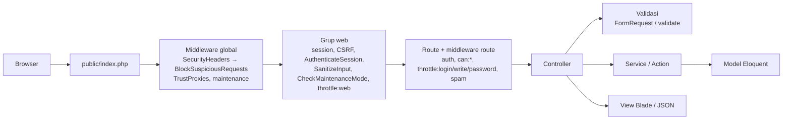

# Arsitektur Mail Sync

## Alur request

- Konfigurasi middleware ada di `bootstrap/app.php` (Laravel 12, tanpa `Kernel.php`).
- Rate limiter bernama (`web`, `login`, `password`, `write`, `api`) didefinisikan di `App\Providers\AppServiceProvider::configureRateLimiting()` dari `config/security.php`.
- Exception: request JSON (`expectsJson()` / `api/*`) → `{status, message, errors?}`; request web → `resources/views/errors/{kode}.blade.php`.

## Layer

| Layer | Lokasi | Tanggung jawab |
| --- | --- | --- |
| Route | `routes/web.php`, `routes/auth.php`, `routes/api.php`, `routes/channels.php` | URL, middleware, nama route |
| Controller | `app/Http/Controllers/{Auth,Backend,Frontend}` | Tipis: terima request → panggil service → response |
| Validasi | `app/Http/Requests` (FormRequest) / `validate()` | Aturan + pesan Bahasa Indonesia |
| Service/Action | `app/Services`, `app/Actions` (buat bila perlu) | Logika bisnis, `DB::transaction()` untuk multi-tabel |
| Otorisasi | Gate/Policy, `Gate::before` Superadmin, permission Spatie | `can:` middleware / `$this->authorize()` |
| Model | `app/Models` | `$fillable` eksplisit, casts, relasi |
| Support | `app/Support` | `Brand` (identitas per request), `ActivityRecorder` (audit) |
| View | `resources/views` | Tanpa query/logika bisnis |

## Modul

| Modul | Route | Controller |
| --- | --- | --- |
| Beranda publik, robots, sitemap | `/`, `/robots.txt`, `/sitemap.xml` | `Frontend\HomeController`, `Frontend\SeoController` |
| Autentikasi | `/admin/login`, `/admin/register`, `/admin/forgot-password`, `/admin/reset-password/{token}`, sosial `/admin/auth/{provider}/*` | `Auth\*` |
| Dashboard | `/admin/dashboard` | `Backend\Dashboard\DashboardAdminController` |
| Akun saya | `/admin/my-account`, `/admin/my-profile`, `/admin/my-security`, `/admin/my-activity`, sesi login | `Backend\MyProfile\*` (dibatasi ke akun sendiri via `Controller::ownAccountOrFail()`) |
| User & peran | `/admin/users`, `/admin/roles` (`can:view_resources`) | `Backend\UserManagement\*` |
| Log aktivitas | `/admin/log-activity` | `Backend\Help\LogActivityController` (non-Superadmin hanya melihat miliknya) |
| Pengaturan | `/admin/settings` (`can:view_resources`) | `Backend\Settings\SettingController` |

## Identitas & branding

- `App\Support\Brand` menggabungkan tabel `settings` (diubah admin) dengan default `config/app.php`, `config/seo.php`, `config/branding.php`. Dibagikan ke semua view sebagai `$brand`.
- `App\Services\BrandingService` + `php artisan app:branding --apply` membuat `public/logo*.svg`, `favicon.*`, `android-chrome-*.png`, `apple-touch-icon.png`, `og-image.png`, `site.webmanifest`.

## Realtime

Reverb (`php artisan reverb:start`) + Echo. Channel privat `App.Models.User.{id}` dipakai untuk `ForceLogoutNotification` (logout paksa setelah ganti password/ban).
