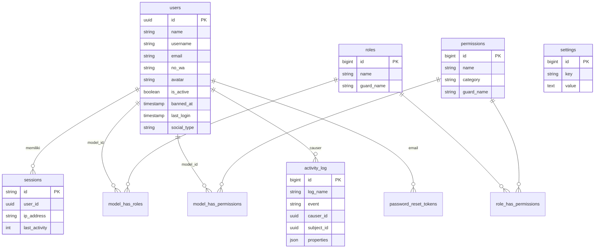

# Database Mail Sync

Driver default: PostgreSQL (`DB_CONNECTION=pgsql`, database `mail_sync`). Primary key `users.id` bertipe **UUID**.

## Tabel

| Tabel | Isi | Catatan |
| --- | --- | --- |
| `users` | Akun pengguna | `id` UUID, `username`, `email`, `no_wa`, `avatar`, `is_active`, `banned_at`, `last_ip`, `last_login`, `social_id`, `social_type`, `nik`, `phone` |
| `password_reset_tokens` | Token reset password | Kedaluwarsa 60 menit (`config/auth.php`) |
| `sessions` | Sesi (SESSION_DRIVER=database) | `user_id` UUID, dipakai fitur riwayat sesi login |
| `cache`, `cache_locks` | Cache database | |
| `jobs`, `job_batches`, `failed_jobs` | Queue | |
| `roles`, `permissions`, `model_has_roles`, `model_has_permissions`, `role_has_permissions` | Spatie Permission | `permissions.category` tambahan untuk pengelompokan |
| `activity_log` | Spatie Activitylog | `causer`/`subject` morph UUID |
| `settings` | Pengaturan key–value | Secret OAuth disimpan terenkripsi (APP_KEY) |

## ERD

## Konvensi migration

- Tabel plural snake_case, pivot alfabetis (`order_product`).
- Foreign key eksplisit dengan `->constrained()->cascadeOnDelete()` / `nullOnDelete()` sesuai kebutuhan.
- Index untuk kolom yang sering difilter/diurutkan.
- Selalu cek dengan `php artisan migrate --pretend` sebelum menjalankan di production.
