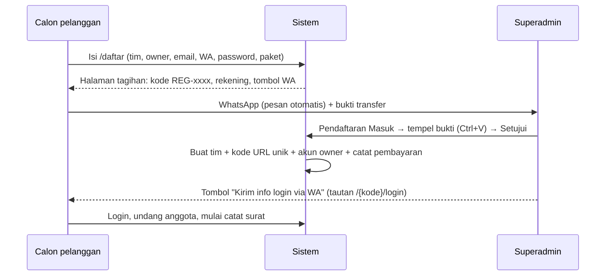

# Alur Bisnis SaaS — Manajemen Surat

## Paket

| Paket | Harga | Masa aktif | Akun |
| --- | --- | --- | --- |
| Bulanan | Rp39.000 | 1 bulan | maks. 3 (termasuk owner) |
| Lifetime | Rp99.000 | selamanya | maks. 3 (termasuk owner) |

Harga, nama, dan kuota akun bisa diubah Superadmin di **Layanan SaaS → Pengaturan Pembayaran**.

## Alamat

| URL | Untuk |
| --- | --- |
| `/` | Beranda + harga |
| `/daftar` | Pendaftaran tim (publik) |
| `/masuk` | Ketik kode tim → diarahkan ke `/{kode}/login` |
| `/admin/login` | **Hanya Superadmin** (akun platform) |
| `/{kode}/login` | Login anggota tim (kode 4 karakter, mis. `/k7qp/login`) |
| `/verifikasi/{token}` | Halaman publik hasil pindai QR surat keluar |

## Pendaftaran & aktivasi

- Superadmin juga bisa **mendaftarkan langsung** (Pendaftaran Masuk → Daftarkan Tim): isi data, pilih paket, tempel bukti → tim langsung aktif.
- Bukti transfer (PNG/JPG/JPEG/PDF, maks. 5 MB) disimpan **privat** — hanya Superadmin yang bisa membukanya.

## Perpanjangan & status

| Status | Arti |
| --- | --- |
| Aktif | Semua fitur jalan. Banner pengingat muncul H-7 dan H-1. |
| Beku | Lewat jatuh tempo + 3 hari tenggang (otomatis, `saas:freeze-expired` tiap 00:15). Data hanya bisa dilihat & diekspor; halaman Langganan tetap terbuka. |
| Dinonaktifkan | Ditetapkan Superadmin. Tim tidak bisa login. |

Perpanjangan: owner buka **Langganan** → transfer → tombol WA → Superadmin buka tim → **Catat perpanjangan** + tempel bukti. Masa aktif dihitung dari jatuh tempo lama (tidak ada hari yang hilang); tim beku otomatis aktif lagi. Upgrade ke lifetime lewat form yang sama.

## Peran tim

| Hak | Owner | Admin | Pimpinan | Staf |
| --- | :-: | :-: | :-: | :-: |
| Catat/ubah surat | ✓ | ✓ | | ✓ |
| Hapus surat | ✓ | ✓ | | |
| Buat disposisi | ✓ | ✓ | ✓ | |
| Setujui surat keluar | ✓ | | ✓ | |
| Data master & template | ✓ | ✓ | | |
| Pengaturan tim (kop, penomoran) | ✓ | ✓ | | |
| Anggota, modul tambahan, langganan | ✓ | | | |

Sumber tunggal aturan ini: `App\Enums\TeamRole::ABILITIES` (Gate `team.*`).

**Pegawai ≠ akun.** Data pegawai (dengan divisi/bidang) tidak memakai kuota 3 akun — dipakai sebagai tujuan disposisi dan penanda tangan. Pegawai bisa ditautkan ke akun agar disposisinya muncul di "Disposisi Saya".

## Alur surat

**Surat masuk:** Catat (nomor agenda otomatis per tahun) → Disposisi ke satu/lebih pegawai (instruksi, tenggat) → Penerima: Mulai proses → Tandai selesai + laporan → surat otomatis **Selesai** bila semua disposisi selesai → Arsipkan.

**Surat keluar:** Pilih template → isi form dengan pratinjau kertas langsung → Ajukan → Pimpinan/Owner **Setujui** (nomor surat & QR terbit) atau **Kembalikan untuk revisi** → Unduh PDF → Tandai terkirim. Nomor baru terbit saat disetujui, jadi draf yang batal tidak memakan nomor.

Lampiran surat cukup tautan Google Drive (server tidak menyimpan file).

## Modul tambahan (dibuka/dikunci owner)

Monitoring Lembur, Perjalanan Dinas (bisa ditautkan ke surat tugas), Honorarium (nilai bersih dihitung otomatis setelah pajak). Modul yang dikunci hilang dari menu; datanya tetap tersimpan.

## Keamanan multi-tenant

- Semua model tim memakai trait `BelongsToTeam` (global scope `team_id`).
- `ResolveTeam` dijalankan **sebelum** route model binding, sehingga ID milik tim lain tidak pernah bisa di-bind (404).
- Login memfilter `team_id`: akun tim tidak bisa masuk `/admin`, akun platform tidak bisa masuk `/{kode}`.
- Template HTML buatan tim disanitasi (`App\Support\HtmlSanitizer`); logo kop diambil lewat `SafeRemoteImage` (anti-SSRF); dompdf tidak boleh mengambil URL sendiri.
